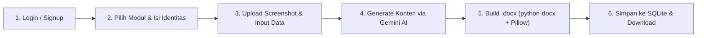

<div align="center">

<!--  -->

# Laprakin — Auto Generate Laprak LabTIF UAD

**Generator Laporan Praktikum (`.docx`) Otomatis Berbasis AI Multimodal**

[](https://www.python.org/)
[](https://flask.palletsprojects.com/)
[](https://ai.google.dev/)
[](https://python-docx.readthedocs.io/)
[](https://www.sqlite.org/)

*Susun laporan praktikum Laboratorium Teknik Informatika (LabTIF) Universitas Ahmad Dahlan dalam hitungan detik — rapi, terstruktur, dan siap kumpul.*

</div>

---

## ✨ Mengapa Laprakin?

Menyusun laporan praktikum secara manual sering memakan waktu karena harus mengatur sampul, penomoran gambar per bab, format *italic* istilah teknis, hingga penamaan file resmi. **Laprakin** mengotomatiskan seluruh proses tersebut dalam satu alur kerja (*wizard*) yang praktis:

- 🤖 **AI Multimodal (Google Gemini)** — Cukup unggah screenshot hasil praktikum dan berikan prompt singkat; sistem otomatis menyusun *Alat & Bahan*, *Langkah Kerja*, keterangan teknis gambar, *Analisis Hasil*, hingga *Ulasan Praktikum*.
- 📄 **Dokumen `.docx` Siap Kumpul** — Menghasilkan file Word berstandar LabTIF UAD lengkap dengan sampul resmi, bab terstruktur (`I. Pre Test`, `II. Hasil Praktikum`, `III. Post Test`, `Ulasan Praktikum`), serta kompresi gambar otomatis via Pillow.
- 🏷️ **Formatting & Penamaan Otomatis** — Penomoran `Gambar 1.x`, `Gambar 2.x`, `Kode Program 2.x`, prefix `Ket : ` pada setiap keterangan gambar, *auto-italic* istilah teknis/asing, dan nama file resmi sesuai aturan tiap modul.
- 🔐 **Sistem Akun & Riwayat** — Login/registrasi pengguna dengan SQLite (`laprakin.db`) sehingga setiap laporan tersimpan rapi dan dapat diunduh ulang kapan saja.
- 📊 **Admin Panel Terproteksi PIN** — Pantau total pengguna, total laporan, distribusi per modul, dan aktivitas terbaru melalui `/admin`.

---

## 📚 Modul Praktikum yang Didukung

| Kode | Mata Kuliah Praktikum | Pertemuan | Tools Utama | Penamaan File Resmi |
|---|---|---|---|---|
| `kdjk` | **Komunikasi Data & Jaringan Komputer** | 14 | Cisco Packet Tracer & Winbox | `<NIM>_<Nama>_<Pertemuan>_KDJK.docx` |
| `sdata` | **Struktur Data** | 11 | C++ | `<NIM>_<Nama>_<Pertemuan>_SData_<PJ>.docx` |
| `basdat` | **Basis Data** | 12 | MySQL, ERD & MongoDB | `<NIM>_<Nama>_<Pertemuan>_BasisData.docx` |
| `statistika` | **Statistika Informatika** | 14 | SPSS, MS Excel & Python | `<NIM>_<Nama>_<Pertemuan>_Statistika_<PJ>.docx` |

<details>
<summary><b>📖 Lihat Daftar Lengkap Topik Pertemuan per Modul</b></summary>

#### 1. Komunikasi Data & Jaringan Komputer (`kdjk`)
1. Sistem Perkabelan (Straight & Cross)
2. Pengalamatan IP (Subnetting & Supernetting)
3. Konfigurasi Point to Point Menggunakan Ubiquiti
4. Fiber Optik
5. LAN dan Aplikasi (Cisco Packet Tracer)
6. Subnetting dan Superneting (CIDR)
7. Routing (Static, RIP, EIGRP, OSPF)
8. DHCP Server dan Domain Name Server (DNS)
9. Virtual LAN (VLAN)
10. Web Server dan Proxy Server
11. Wireless LAN
12. User Profile (Hotspot MikroTik)
13. Manajemen Bandwidth
14. Virtual Private Network (VPN)

#### 2. Struktur Data (`sdata`)
1. Array Statis
2. Array Dinamis
3. Linked List
4. Variasi Linked List (Circular & Doubly Linked List)
5. Stack dengan Array
6. Queue
7. Circular Queue
8. Priority Queue
9. Tree (General Tree)
10. Binary Search Tree (BST)
11. BST Seimbang (AVL Tree)

#### 3. Basis Data (`basdat`)
1. Identifikasi Entitas untuk Studi Proyek
2. Konversi Model Data ke Tabel
3. Normalisasi (1NF, 2NF, 3NF)
4. Data Definition Language (DDL)
5. Indeks
6. DML dan Fungsi Agregasi
7. Relasi Tabel dengan Join
8. Trigger, Keamanan Data, dan Stored Procedure
9. Pengenalan NoSQL (MongoDB Atlas & Compass)
10. Operasi CRUD pada NoSQL
11. NoSQL Index dan Agregasi
12. NoSQL - Pemrograman dengan Python (PyMongo)

#### 4. Statistika Informatika (`statistika`)
1. Pembentukan Distribusi Frekuensi
2. Pembentukan Distribusi Frekuensi Kumulatif
3. Ukuran Pemusatan: Mean dan Median
4. Ukuran Pemusatan: Modus dan Kuartil
5. Ukuran Penyebaran Data: Deviasi Rata & Standar Deviasi
6. Ukuran Penyebaran Data dengan Pemrograman Python
7. Probabilistik Dasar dan Probabilistik Bersyarat
8. Distribusi Teoritis (Binomial dan Normal)
9. Distribusi Teoritis (Hipergeometrik dan Poisson)
10. Uji Hipotesis (Parameter Mean - 1 Sampel)
11. Uji Hipotesis dengan 2 Sampel Berpasangan
12. Uji Reliabilitas dan Uji Validitas
13. Inhal Praktikum
14. Ujian Responsi Praktikum

</details>

---

## 🔄 Alur Kerja Sistem



---

## 🗂️ Struktur Proyek

```text
laprak-generator/
├── app.py                  # Aplikasi utama Flask, autentikasi, & routing API
├── db.py                   # Koneksi & inisialisasi schema SQLite (users, reports)
├── docx_generator.py       # Builder dokumen .docx, metadata modul, & auto-italic
├── gemini_service.py       # Integrasi multimodal Google Gemini API
├── requirements.txt        # Dependensi Python (Flask, python-docx, Pillow)
├── static/
│   ├── css/style.css       # Stylesheet antarmuka web
│   ├── img/logo-uad.png    # Logo resmi UAD untuk sampul laporan
│   └── js/wizard.js        # Logika interaktif wizard generator
└── templates/
    ├── index.html          # Halaman utama wizard generator
    ├── admin.html          # Dashboard admin (PIN 4 digit)
    ├── login.html          # Halaman masuk
    ├── signup.html         # Halaman pendaftaran
    ├── forgot_password.html# Reset password pengguna
    ├── base_auth.html      # Layout dasar halaman autentikasi
    └── legal.html          # Informasi privasi, ketentuan, & akun
```

---

## 🚀 Instalasi & Cara Menjalankan

### Prasyarat
- **Python 3.10+** (diuji pada Python 3.12)
- **API Key Google Gemini** dari [Google AI Studio](https://aistudio.google.com/)

### 🐧 Linux / macOS

```bash
# 1. Buat dan aktifkan virtual environment
python3 -m venv .venv-linux
source .venv-linux/bin/activate

# 2. Install dependensi
pip install -r requirements.txt

# 3. Set API Key Gemini (atau simpan di file .env)
export GEMINI_API_KEY="api_key_gemini_anda"

# 4. Jalankan aplikasi
python app.py
```

### 🪟 Windows

```powershell
# 1. Buat dan aktifkan virtual environment
python -m venv .venv
.venv\Scripts\activate

# 2. Install dependensi
pip install -r requirements.txt

# 3. Set API Key Gemini
set GEMINI_API_KEY=api_key_gemini_anda

# 4. Jalankan aplikasi
python app.py
```

Setelah server berjalan, buka browser dan akses:
- **Aplikasi Utama:** `http://127.0.0.1:5000`
- **Admin Panel:** `http://127.0.0.1:5000/admin` (PIN default: `2026`)

---

## ⚙️ Konfigurasi Environment Variable

| Variabel | Fungsi | Nilai Default |
|---|---|---|
| `GEMINI_API_KEY` | API Key Google Gemini untuk generasi teks & analisis gambar (bisa juga ditulis di `.env`) | *(wajib untuk fitur AI)* |
| `LAPRAKIN_ADMIN_PIN` | PIN 4 digit untuk membuka dashboard `/admin` | `2026` |
| `LAPRAKIN_SECRET_KEY` | Secret key untuk enkripsi Flask session | `laprakin-labtif-uad-2026-secret` |

---

## 🔌 Daftar Endpoint Utama

<details>
<summary><b>Klik untuk melihat daftar route & API</b></summary>

| Method | Endpoint | Deskripsi |
|---|---|---|
| `GET` | `/` | Halaman utama wizard generator (memerlukan login) |
| `GET / POST` | `/login`, `/signup`, `/forgot-password` | Autentikasi & manajemen akun pengguna |
| `GET` | `/logout` | Keluar dari sesi pengguna |
| `POST` | `/api/ai/generate` | Menghasilkan konten laporan & keterangan gambar via Gemini AI |
| `POST` | `/api/generate` | Membangun file `.docx` dan menyimpan riwayat ke database |
| `GET` | `/api/reports` | Mengambil daftar riwayat laporan milik pengguna |
| `GET` | `/api/reports/<id>/download` | Mengunduh ulang file `.docx` berdasarkan ID laporan |
| `GET` | `/admin` | Halaman Admin Panel |
| `POST` | `/api/admin/auth`, `/api/admin/logout` | Autentikasi PIN & kunci ulang Admin Panel |
| `GET` | `/api/admin/stats` | Statistik total pengguna, laporan, dan distribusi modul |

</details>
